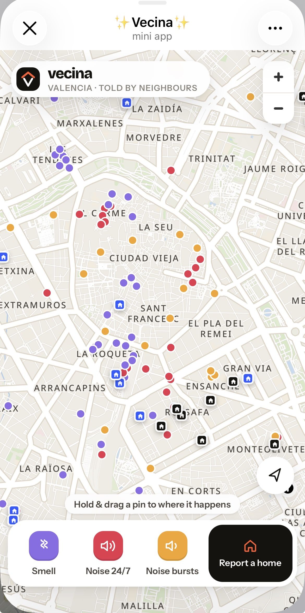
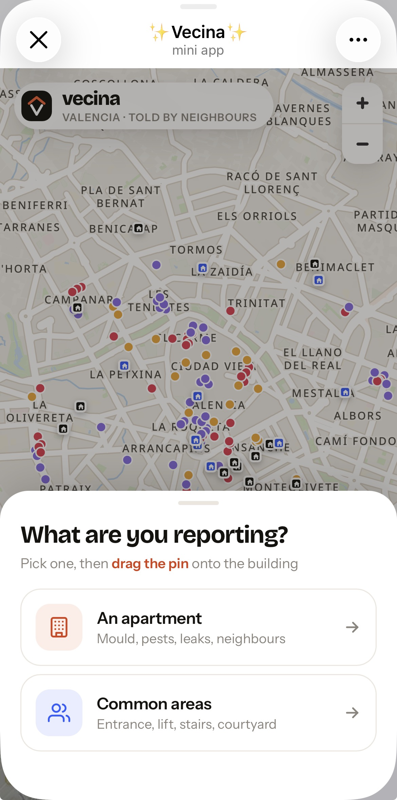
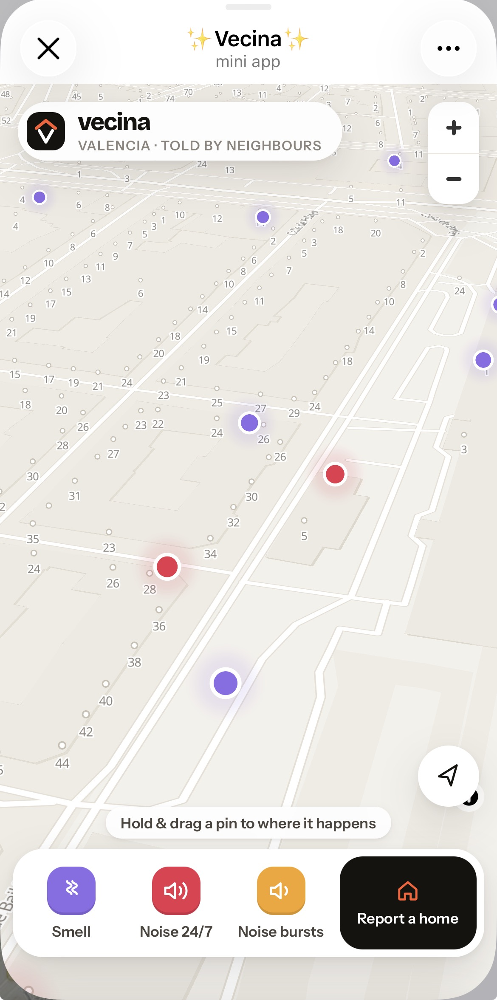

<p align="center">
  
</p>

<p align="center"><strong>The things a viewing won't show you.</strong><br>
Neighbour-reported noise, smells and building issues across Valencia — on one map.</p>

<p align="center">
  <a href="https://t.me/vecina_app_bot?profile"></a>
</p>

<p align="center">
  
  
  
  
  
</p>

---

A flat can look perfect for the twenty minutes of a viewing. Then you move in and meet the 3 a.m. bar crowd, the drain smell, the mould behind the wardrobe and the lift that has been "being fixed" since spring.

**Vecina** is a crowdsourced map of exactly that. People who actually live on the street pin what they hear, smell and deal with — anonymously, and only where they physically are. Renters check an address before they sign.

<p align="center">
  
  &nbsp;
  
  &nbsp;
  
</p>

## What it does

**Street-level pins.** Drag a pin from the dock onto the map: *Smell*, *Noise 24/7* or *Noise bursts*. Each pin gets a soft aura on the map that hints at how far the problem reaches.

**Building reports.** Flag a specific apartment (mould, pests, no hot water, illegal tourist flat…) or the common areas (broken lift, unsecured entrance, dirty stairwell…). Several reports on one building are grouped into a single card.

**Confirm or dispute.** Neighbours vote on existing pins, so stale or false reports fade and real ones get backed up. Authors can add a short note or delete their own pins.

**Honest by design.** Pins can only be dropped within 100 m of your real location. Sign-in is anonymous — no accounts, no personal data.

**Lives in Telegram.** Runs as a Telegram Mini App out of the box, and as a normal web page everywhere else.

## Stack

| Layer | Technology |
|---|---|
| Map | [MapLibre GL JS](https://maplibre.org/) with a custom light style |
| Basemap | [PMTiles](https://protomaps.com/docs/pmtiles) — one static file built from OpenStreetMap via [Protomaps](https://protomaps.com/) |
| Data & auth | [Firebase](https://firebase.google.com/) — Firestore + Anonymous Auth |
| Geocoding | [Nominatim](https://nominatim.org/) (rate-limited queue, 1 req/s) |
| Mini App | [Telegram WebApp SDK](https://core.telegram.org/bots/webapps) |
| Hosting | Any static host — configured for [Netlify](https://www.netlify.com/) |

## Project structure

```
.
├── index.html                 entry point
├── app.js                     map style, Firebase wiring, UI logic
├── style.css                  design tokens + all UI styles
├── valencia.pmtiles           basemap tiles
├── addresses_light.geojson    house-number overlay (zoom 17+)
├── netlify.toml               headers for serving .pmtiles
├── brand/                     logo, mark, Telegram avatar (SVG + PNG)
└── docs/                      README screenshots
```

## Run locally

No build step. Serve the folder with any static server:

```bash
npx serve .
```

## Deploy

`netlify.toml` sets the `Content-Type`, byte-range and CORS headers that `.pmtiles` needs. Vercel, GitHub Pages or any host with custom headers works the same way once those headers are replicated.

## Firebase

The app expects a Firebase project with:

- **Firestore**
  - `markers` — street-level pins (`smell`, `noise-permanent`, `noise-temporary`), each with a `votes` subcollection
  - `reports` — building reports (`apartment`, `community`)
- **Anonymous Authentication** enabled

> The Firebase web config in `app.js` is public by design. Access is controlled by **Firestore Security Rules** — make sure users can only edit or delete their own markers, reports and votes. The 100 m placement limit is enforced in the client only.

## Brand

| Token | Value | Use |
|---|---|---|
| Ink | `#16130F` | text, primary buttons, mark background |
| Naranja | `#FF5B2E` | accent, user location, roof in the mark |
| Azul | `#2D5BFF` | common-area reports |
| Paper | `#FBF9F6` | app background |
| Smell / Noise 24/7 / Noise bursts | `#8B6CE8` / `#E8344E` / `#F5A524` | pin categories |

Type: **Bricolage Grotesque** for headings, **Instrument Sans** for UI. The logo is drawn as outlines (no font dependency); source files live in `brand/`.

## Data sources

- `valencia.pmtiles` — © [OpenStreetMap](https://www.openstreetmap.org/copyright) contributors, via Protomaps
- `addresses_light.geojson` — trimmed address points; the full source file is not included (too large, not needed to run)

Not in this repo: the `cloudflared` and `pmtiles` CLIs used during development (`brew install cloudflared pmtiles`) and raw intermediate data.

## Contributing

Issues and PRs are welcome. Vecina is early-stage and Valencia-only for now — help bringing it to other cities is especially appreciated.

## License

TBD
