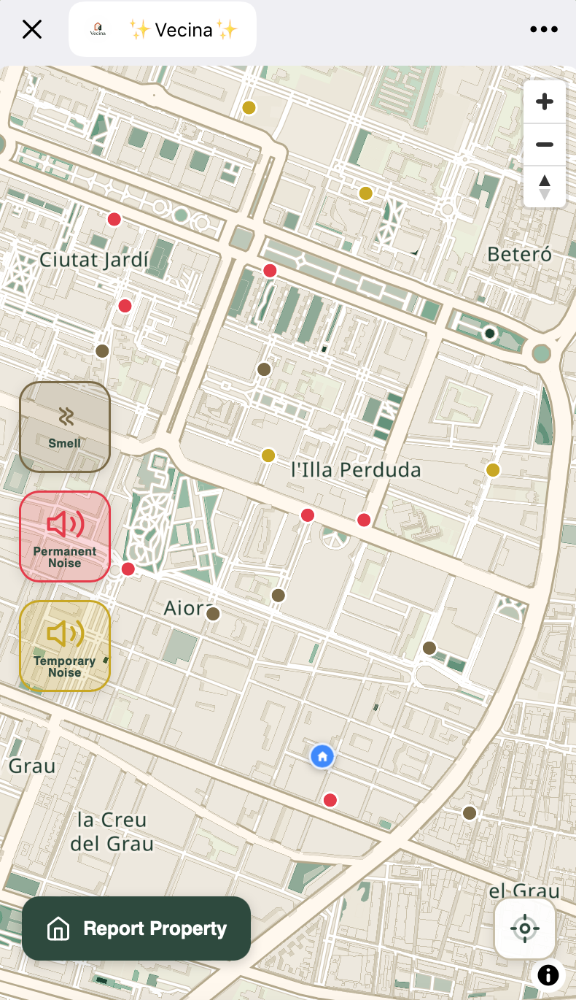
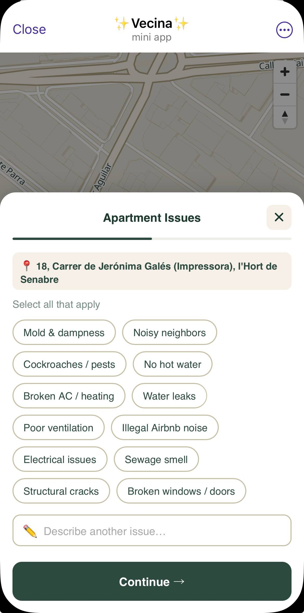
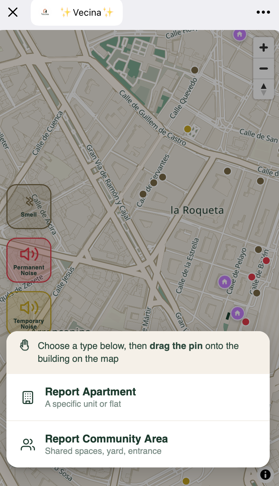

<p align="center">
  
</p>

<h1 align="center">Vecina</h1>

<p align="center"><strong>Find out what rental agents and homeowners might not tell you.</strong></p>

Vecina is a crowdsourced, map-based tool for discovering and reporting neighborhood and property issues in Valencia, Spain — street noise, noisy neighbors, smells, mold, pests, and other problems that are easy to hide during a quick apartment viewing but hard to live with every day.

Anyone who has ever had to relocate knows how difficult it is to weigh every factor before signing a lease. Vecina surfaces the invisible ones — reported anonymously by the people who actually live nearby.

<p align="center">
  
  <br>
  <em>Map view with issue pins</em>
</p>

[](https://maplibre.org/)
[](https://protomaps.com/docs/pmtiles)
[](https://firebase.google.com/)
[]()
[](https://core.telegram.org/bots/webapps)
[]()

---

## ✨ Features

- 🗺️ **Interactive map of Valencia** rendered with MapLibre GL JS and a self-hosted PMTiles basemap — no tile server, no API keys for map rendering
- 📍 **Drop a pin** for smells, permanent noise, or temporary noise, right where it happens
- 🏢 **Report a building** — flag issues with a specific apartment (mold, pests, no hot water, illegal Airbnb noise, etc.) or a shared community area (broken elevator, dirty common spaces, unsecured entrance, etc.)
- 👍👎 **Vote on existing reports** to confirm or dispute what others have flagged, plus short notes
- 📡 **Location-gated reporting** — pins can only be placed near your actual location, keeping reports honest
- 🕵️ **Anonymous by design** — Firebase Anonymous Auth means no accounts, no personal data, just verified proximity
- 📱 **Works as a Telegram Mini App** out of the box via the Telegram WebApp SDK
- ⚡ **Zero build step** — plain HTML/CSS/JS, deployable to any static host

<p align="center">
  
  <br>
  <em>Report flow — drag pin, select issues, submit</em>
</p>

<p align="center">
  
  <br>
  <em>Voting on a report and viewing building details</em>
</p>

## 🧱 Stack

| Layer | Technology |
|---|---|
| Map rendering | [MapLibre GL JS](https://maplibre.org/) |
| Basemap tiles | [PMTiles](https://protomaps.com/docs/pmtiles) — single static file, generated from OpenStreetMap via [Protomaps](https://protomaps.com/) |
| Data & auth | [Firebase](https://firebase.google.com/) (Firestore + Anonymous Auth) |
| Mini App integration | [Telegram WebApp SDK](https://core.telegram.org/bots/webapps) |
| Hosting | Static — configured for [Netlify](https://www.netlify.com/), works on Vercel/GitHub Pages too |

## 📁 Project structure

```
.
├── index.html                # entry point
├── app.js                    # map logic, Firebase wiring, UI behavior
├── style.css                 # styles
├── valencia.pmtiles          # basemap tiles (roads, buildings, water, labels)
├── addresses_light.geojson   # house-number points overlay
└── netlify.toml               # sets correct headers for serving .pmtiles
```

## 🚀 Running locally

No build step required. Serve the folder with any static file server:

```bash
npx serve .
```

Then open the printed local URL in your browser.

## ☁️ Deployment

Configured for **Netlify** — `netlify.toml` sets the `Content-Type` and CORS headers `.pmtiles` needs to load correctly. Any static host that supports custom headers works the same way (e.g. Vercel, GitHub Pages), as long as you replicate the byte-range and CORS headers.

## 🔥 Firebase setup

Vecina expects a Firebase project with:

- **Firestore** enabled, with two collections:
  - `markers` — point reports (smell / noise), each with a `votes` subcollection
  - `reports` — per-building issue reports (apartment / community area)
- **Anonymous Authentication** enabled

> The Firebase Web config in `app.js` is safe to keep public — this is standard for Firebase client SDKs. Access control is enforced through **Firestore Security Rules**, not by hiding the API key. Make sure your rules restrict writes so a user can only edit or delete their own markers and reports before deploying.

## 🗺️ Data sources

- `valencia.pmtiles` — generated from OpenStreetMap data via [Protomaps](https://protomaps.com/)
- `addresses_light.geojson` — a trimmed address-point dataset; the full source file used to generate it isn't included in this repo (too large, and not needed to run the app)

## 🚫 Not included in this repo

- `cloudflared`, `pmtiles` CLI tools used during development — install separately (e.g. `brew install cloudflared`, `brew install pmtiles`)
- Raw/intermediate data files used to build `addresses_light.geojson`

## 🤝 Contributing

Issues and pull requests are welcome. This is an early-stage project focused on Valencia — contributions extending coverage to other cities are of particular interest.

## 📄 License

_TBD_